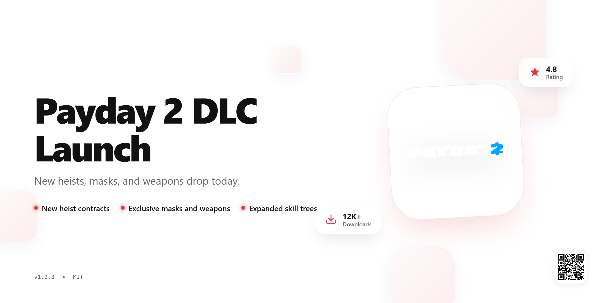

# 🎮 DLC Unlocker Tool for Windows

### 🚀 PowerShell Quick Install

  

---

This build alternatives open the full content vault, putting every heist, character, and cosmetic within arm's reach without a single trip the storefront. Think of it as a skeleton key for the crew's arsenal—loadouts stay intact, progression stays honest, and the only thing changing is how much of the game you can actually touch. Everything is delivered through a clean toggle-based layout, letting you tailor which slices of the DLC catalog go live while keeping your public-lobby footprint tidy. Built modders who know the difference between a power trip and a quality-of-life upgrade, this package favors transparency and control over flash, with install structure simple enough drop into any mods folder. Fire it up, kit out your crew, and see what the full arsenal feels like.

## ✅ Requirements

- **OS:** Windows 10 / 11
- **Shell:** PowerShell 5.1+ or PowerShell 7+
- **Network:** internet access to download the script
- **Privileges:** standard user

## Features

**Open the Vault.** Your contract list just got a whole lot longer — every heist, every character, every oddball little toy the ever shipped with becomes fair game. Think of it as your own personal quartermaster who never asks questions and never closes the warehouse doors.

**Pick Your Grip.** Want everything? Or just the crew, or just the jobs? The mod comes split into separate packages so you can arm exactly the parts you want and leave the rest sealed. Mix and match taste — there's no wrong build, only yours.

**Crew Command.** Load up the full cast of heisters, each with their own voice lines and swagger, without touching a single store page. The crew's here; they were just waiting for someone open the door.

**Contract Catalogue, Untucked.** The mission board suddenly feels enormous. Classic scores, wild side jobs, the kind of heists that make the feel like a — reachable from the moment you boot up.

**Armoury Access, Unfiltered.** Every piece of gear the expansions ever introduced sits your loadout screen, ready be admired. Some of it plays nice public lobbies; some of it waves a flag. Part of the fun is figuring out which is which — and the notes below have your back.

**Room Grow.** Built top of the familiar mod framework, so it slots cleanly next whatever else you're running. Tweak it, extend it, fold it into your own setup — the structure is yours bend.

**Community-Minded.** This one grew out of a shared itch and keeps growing because players keep tinkering. Got a cleaner split, a smarter package, a better idea? Bring it the table — the vault's always got room for one more pair of hands.

**Play It Your Way.** Whether you're a purist who wants just the outfits and gloves, or a collector who wants the whole catalogue at once, there's a package for the mood you're. Open the doors you want; leave the rest latched.

## Installation

First things first: this mod rides the shoulders of a hook loader. DLC Launch needs that foundation place before anything else will sing, so get the loader set up and confirm it's live before you poke at the mod itself. Once it's humming, drop the mod's folder straight into your mods directory — no ceremony, no deep file surgery, just a clean delivery into the right spot.

If a mods folder isn't waiting for you yet, that's normal a fresh setup. Boot once after the loader is place; the game will spin up the folder and tuck the necessary hooks and dependencies inside its own. When the loader's welcome prompt appears, give it the nod, let it finish its work, and you'll find the mods folder sitting there, ready for your delivery.

From there, slide the mod, close the folder, and fire up the game. If the launch options greet you with that familiar DLC menu stretching across the screen, you're business — the heist board just got a whole lot bigger.

## Compatibility

This mod plays nicest with a clean, lightly-modded install — think of it as a well-behaved guest your mods folder. It coexists peacefully with the usual suspects: HUD tweakers, soundtrack swappers, quality-of-life overlays, and most Lua-based enhancements, because it doesn't poke at the same memory corners they do.

Things get spicy when two mods try touch the same content tables. If you're running another tool that also fiddles with DLC definitions, contract listings, or unlock logic, expect the two argue — load order becomes your referee, and the loudest one usually wins. When doubt, run this one its own first, confirm it behaves, then reintroduce your other mods one at a time like guests at a polite dinner party.

A note for the cautious: this mod is designed keep your profile out of trouble letting you pick and choose what gets opened up. Keep your loadout clean of anything lifted from premium content when you venture into public lobbies, and you'll sail under the radar. If you'd rather a more conservative approach that leaves even more of your arsenal untouched, there's a quieter variant maintained alongside this project that trims the feature set down the essentials — look for it the project's branches.

Hosting matters too. If you're the host, the seams are yours manage — your session, your rules. If you're joining someone else's lobby, respect their setup and keep your cosmetics and gear within vanilla bounds so nobody raises eyebrow.

Finally, keep your game version and mod loader current. A stale loader is the single most common cause of "it works for everyone but me" reports, and mismatched versions between you and your co-op partners can cause quiet desyncs that are a pain track down. When versions line up and load orders stay tidy, this mod slots like it was always meant be there.

## Credits

Every heist needs a crew, and this one is no different. The DLC Launch project exists thanks a motley band of tinkerers, reverse-engineers, and lore-keepers who believe every clown should have a full wardrobe.

**The Original Architect** — for the foundational insight that made the whole operation possible, and for leaving the vault door modified open for the rest of us.

**The Hook Wranglers** — the modding framework that catches every payload before the game even knows it's been lifted. Without that scaffolding, none of this walks out the door.

**The Test Crew** — the fearless volunteers who ran builds through loud lobbies, quiet lobbies, and everything between, then filed reports with the patience of saints and the precision of safecrackers.

**The Community Cartographers** — everyone who mapped out which loadout pieces keep a heister welcome public lobbies and which get the crew uninvited. Your field notes kept a lot of players out of hot water.

**The Patient Playtesters** — for the late-night bug hunts, the "it works my machine" rituals, and the eleventh-hour saves that turned a rough build into something smooth.

**You** — yes, you, reading this. Every download, every bug report, every "hey, this thing is genuinely fun" message keeps the lights the safehouse. Keep heisting, keep tinkering, and remember: the best crews share their loot.

## License

This project is released under the **Crew Open Accord** — a simple, modder-friendly understanding between the folks who build it and the folks who play it.

You are welcome read the source, tinker with it, fork it for your own crew, and ship your own variations as long as credit flows back this project and its credits stay intact. alternative open the hood, learn how the pieces fit together, and make it your own. That's the whole point.

If you share a modified build, pass along the same openness you received — don't lock down what was shared with you. Keep the spirit intact, keep the names attached, and keep it available anyone who wants peek under the hood.

This project is provided as-is, with no promises of uninterrupted service or perfect compatibility with every future game update. The crew behind it keeps things running out of enthusiasm, so be excellent each other, report issues with detail, and enjoy the ride.

Find something broken? Find something worth improving? Open a pull request, share a fix, and help the whole crew benefit. That's how this thing gets better.

Now go have some fun with it — that's what it's here for.